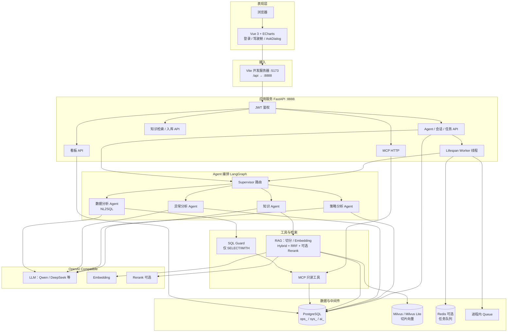
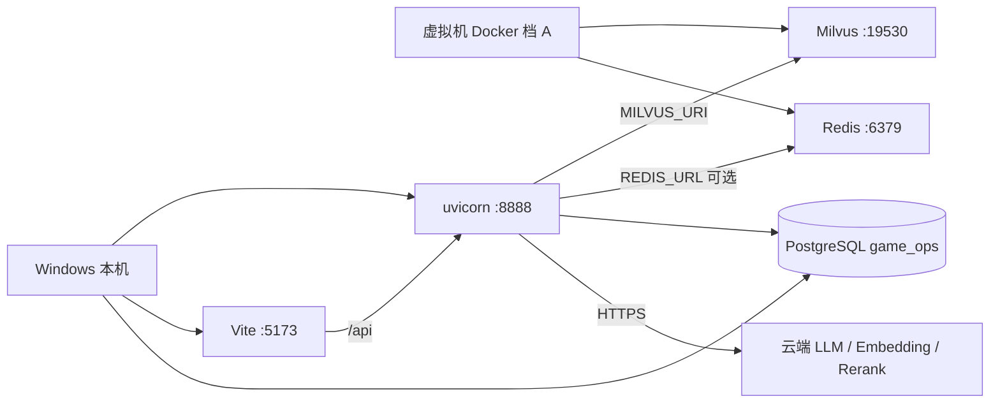

# 系统整体架构、技术与实现方式

**系统名称：** 游戏平台账号租赁智能运营分析系统  
**对应代码：** 仓库当前实现（非仅设计稿）  
**使用说明：** [06-系统使用手册.md](06-系统使用手册.md)

---

## 1. 一句话架构

浏览器中的 Vue 驾驶舱通过 Vite 代理访问本机 FastAPI；看板直接查 PostgreSQL；自然语言经 Supervisor（LangGraph）路由到数据分析、知识、异常、策略四类 Agent；数据 Agent 经 SQL 守卫与 MCP 只读查库；知识 Agent 走 Hybrid RAG（向量 + BM25 + RRF，可选 Rerank）；会话与任务写入 `ai_*` 表；异步智能问答走内存队列或 Redis。

---

## 2. 整体架构图



### 2.1 部署拓扑（当前推荐）



- **前期原则：** 功能在本机跑通；Compose 只编排基础设施，应用不进镜像。  
- **Nginx / 应用 Docker：** 后置，不作为当前验收条件。

---

## 3. 技术选型

| 层级 | 技术 | 本仓库落点 | 作用 |
|------|------|------------|------|
| 前端 | Vue 3、Vite、ECharts | `frontend/` | 驾驶舱、登录、问答 |
| 后端 | Python、FastAPI、Uvicorn | `backend/app/` | REST、SSE、鉴权、生命周期 Worker |
| ORM | SQLAlchemy | `backend/app/models/` | `ops_` / `sys_` / `ai_` |
| Agent | LangGraph、LangChain 风格 LLM 客户端 | `backend/app/agent/` | Supervisor + 多 Agent |
| 工具 | MCP + Function 风格 HTTP | `backend/app/mcp/` | 只读业务查询 |
| RAG | Embedding、Milvus、BM25、RRF、HTTP Rerank | `backend/app/rag/` | 知识检索 |
| 主库 | PostgreSQL | `.env` `DATABASE_URL` | 业务、指标、原文切片、会话任务 |
| 向量 | Milvus Standalone 或 Lite | `vector_store.py` | chunk 向量 |
| 队列 | Redis 或 `queue.Queue` | `backend/app/queue/` | 智能问答异步任务 |
| 模型 | OpenAI Compatible | `agent/llm.py`、`rag/embeddings.py` | 生成与向量化 |
| 鉴权 | JWT | `core/security.py`、`api/v1/auth_api.py` | 登录态 |
| 观测 | LangSmith | 可配置，后置 | 链路追踪（未作为 MVP 必选项） |

---

## 4. 功能与实现方式

### 4.1 登录鉴权（F01）

- **功能：** 运营 / 管理员登录；保护看板、Agent、MCP、知识接口。  
- **实现：** `POST /api/v1/auth/login` 校验 `sys_user`，签发 JWT；`get_current_user` 挂在路由依赖上。知识入库校验 admin。前端 `LoginView` → Token 本地存储 → `DashboardView`。

### 4.2 运营看板（F02）

- **功能：** 区间总览、趋势、游戏排行、游戏详情。  
- **实现：** `services/dashboard.py` 聚合 `ops_daily_metric` 等；`api/v1/dashboard.py` 暴露 GET；前端 ECharts 折线/条形图。同步秒级查询，不经过 LLM。

### 4.3 NL2SQL / 数据分析 Agent（F03）

- **功能：** 自然语言 → SQL → 结论。  
- **实现：**  
  1. `agent/schema.py` 提供表结构与 CTE/排行模板提示。  
  2. `agent/nl2sql.py` 调 LLM 生成 SQL，提取时保留 `WITH`，缺省补全，括号/FROM 自检。  
  3. 校验或执行失败最多再生成 1 次。  
  4. `mcp/sql_guard.py` 仅允许单条 `SELECT`/`WITH`，拦截写操作与多语句。  
  5. 经 MCP `run_readonly_sql` 或指标工具查 PostgreSQL。  
  6. 再用 LLM 把结果写成中文结论；SQL 与行数回传，执行写入 `ai_agent_execution`。

### 4.4 异常分析 Agent（F04）

- **功能：** 「近 N 天 vs 前 N 天」对比全站 GMV/订单/出租率/退款率，并下钻游戏贡献。  
- **实现：** `services/anomaly.py` 做窗口统计；`agent/anomaly.py` 组织话术。Supervisor 路由 `anomaly` / `anomaly_knowledge`（后者再调知识 Agent）。

### 4.5 RAG 知识库与知识 Agent（F05）

- **功能：** 按规则文档问答；无命中不编造。  
- **实现链路：**

```text
data/knowledge/*.md
  → chunker 切分
  → embeddings 向量化
  → Milvus 存向量 + PG ops_knowledge_doc/chunk 存原文
  → 检索：Metadata 过滤 → 向量召回 + BM25 → RRF
  → 可选 HTTP Rerank（失败 fail-open）
  → 词面重叠过滤弱命中
  → knowledge Agent 基于 hits 作答，附 refs
```

- **代码：** `rag/ingest.py`、`retriever.py`、`bm25_index.py`、`rrf.py`、`rerank.py`、`agent/knowledge.py`。  
- **入库：** `scripts.ingest_knowledge` 或 `POST /knowledge/ingest`（admin）。

### 4.6 策略分析 Agent（F06）

- **功能：** 基于指标快照（可选知识）输出运营建议。  
- **实现：** `agent/strategy.py`；硬约束：对话中的写库/改价落库意图走 Supervisor `reject`。回答需强调不自动修改业务数据。

### 4.7 Supervisor（F07）

- **功能：** 一问自动选路并汇总。  
- **实现：** LangGraph `StateGraph`（`agent/supervisor.py`）。LLM 输出 JSON `route`；解析失败则用关键词启发式。路由：

| route | 调用 |
|-------|------|
| `data` | NL2SQL |
| `knowledge` | RAG 问答 |
| `both` | 数据 + 知识再综合 |
| `anomaly` / `anomaly_knowledge` | 异常（+ 知识） |
| `strategy` / `strategy_knowledge` | 策略（+ 知识） |
| `reject` | 拒绝写操作 |

综合节点用 `SYNTH_PROMPT` 合并各路结论，禁止编造数字。

### 4.8 MCP 工具层（F08）

- **功能：** 标准化只读查询，给 Agent 与外部客户端。  
- **实现：** `mcp/registry.py` 注册工具；HTTP `GET/POST /api/v1/mcp/tools...`；stdio：`python -m app.mcp.server`。工具包括：`list_games`、`query_gmv`、`query_rent_rate`、`query_orders_summary`、`query_game_metric_rank`、`run_readonly_sql`。

### 4.9 会话与任务（F09）

- **功能：** 每次问答可追溯。  
- **实现：** `ai_session` / `ai_task` / `ai_agent_execution`；`services/ai_trace.py` 落库；敏感 SQL 摘要脱敏。前端「查看执行步骤」拉 `GET .../executions`。

### 4.10 异步任务队列

- **功能：** 智能模式不长时间占死 HTTP 请求。  
- **实现：** `queue/jobs.py`：`REDIS_URL` 有值则 Redis `LPUSH`/`BRPOP`，否则内存 `Queue`。`main.py` lifespan 启动 `start_worker_thread`，出队后跑 Supervisor 并回写任务状态。前端 `enqueueSupervisorAsk` + `waitForTask`。

### 4.11 流式输出（SSE）

- **功能：** 问数 / 问规则 / 同步 Supervisor 可边生成边推。  
- **实现：** `agent/sse.py` 事件：`phase`、`meta`、`token`、`done`、`error`。路径：`/ask/stream`、`/nl2sql/stream`、`/knowledge/stream` 等。

---

## 5. 数据模型（实现口径）

| 前缀 | 用途 | 代表表 |
|------|------|--------|
| `sys_` | 系统 | `sys_user`、`sys_audit_log` |
| `ops_` | 业务 | `ops_game`、`ops_account`、`ops_player`、`ops_order`、`ops_refund`、`ops_daily_metric`、`ops_knowledge_doc`、`ops_knowledge_chunk` |
| `ai_` | Agent | `ai_session`、`ai_task`、`ai_agent_execution` |

原则：UUID 主键；库内不建物理外键；向量在 Milvus，原文与 `chunk_id` 在 PostgreSQL。详细字段见 [04-系统设计.md](04-系统设计.md)。

---

## 6. 运行时核心链路

**看板**

```text
运营选日期 → GET /dashboard/* → services/dashboard → PostgreSQL → ECharts
```

**智能问答（默认前端路径）**

```text
提问 → 创建 session → POST ask/async → 队列
     → Worker → Supervisor 路由
         ├─ NL2SQL → Guard → MCP → PG
         ├─ RAG → Milvus + BM25 + RRF → 可选 Rerank → PG 原文
         ├─ 异常窗口对比
         └─ 策略只读建议
     → 写入 ai_task / executions → 前端轮询展示
```

---

## 7. 目录与模块对应

```text
frontend/
  views/LoginView.vue          登录
  views/DashboardView.vue      驾驶舱
  components/AskDialog.vue     智能 / 问数 / 问规则
  api/                         HTTP 封装

backend/app/
  api/v1/                      路由
  core/                        配置、JWT、统一响应、DB
  services/                    看板、异常统计、鉴权用户、任务落库
  agent/                       Supervisor、NL2SQL、知识、异常、策略、SSE
  mcp/                         工具注册、SQL 守卫、stdio Server
  rag/                         切分、向量、BM25、RRF、Rerank、检索、入库
  queue/                       异步任务
  models/                      ORM

data/knowledge/                模拟运营文档
docker/                        档 A：Milvus + Redis（可选 Postgres profile）
```

---

## 8. 安全实现要点

| 约束 | 实现 |
|------|------|
| AI 只读 | SQL Guard + MCP 工具不提供写接口 |
| 策略不写库 | Supervisor `reject` + 策略 Prompt 约束 |
| 密钥不进仓库 | `.env` / 环境变量 |
| 接口鉴权 | JWT；ingest 限 admin |
| 检索诚实性 | 无命中固定话术，禁止伪造规则 |
| 出站 HTTP | Embedding/Rerank 使用 `trust_env=False`，避免本机代理干扰 |

---

## 9. 与设计文档的差异（以代码为准）

| 设计稿（docs/04）曾写 | 当前实现 |
|----------------------|----------|
| Nginx 统一入口 | 开发期 Vite 代理，未上 Nginx |
| Redis 仅缓存后置 | Redis 已用于可选任务队列 |
| Rerank / Hybrid 规划项 | Hybrid+RRF 已默认；Rerank 开关默认开，未配密钥则跳过 |
| 异常/策略为 P1 | 均已接入 Supervisor |

需求真源仍以 [docs/01](01-游戏平台账号租赁智能运营分析系统_项目开发需求前置文档_V1.0.md)、[docs/02](02-需求规格说明书.md) 为准。
